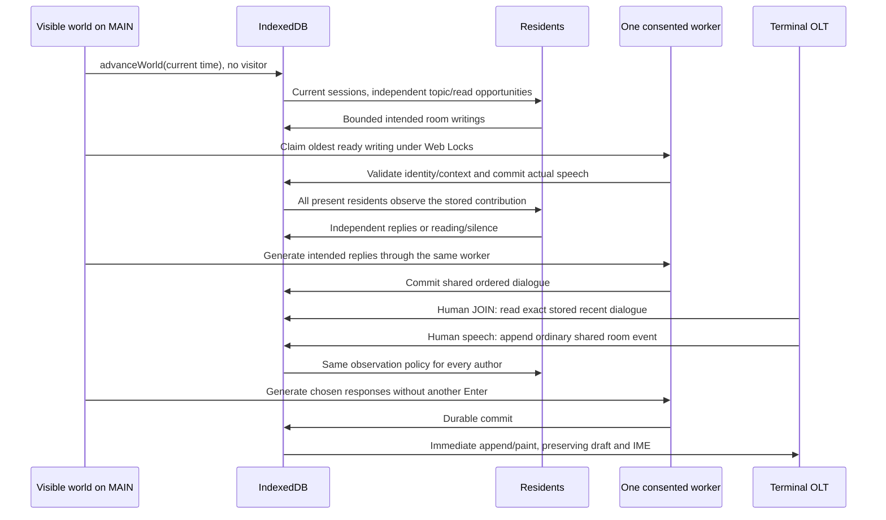

# Browser-local resident community

The ordinary terminal requires no model, GPU, external API key or inference server.
100 original fictional residents inhabit the single-user local world. They never
represent historical PC-VAN members or real connected users. The modern Settings
dialog is outside the simulated service; the model cannot change historical
fixtures, menus or command semantics.

## Conversational setting

Forum posts, private letters and OLT turns share system guidance for **present-day
interaction in a 1996-inspired PC-VAN community**. The trusted prompt supplies the
current JST interaction date. The retro interface does not establish a 1996
calendar or a period knowledge cutoff: modern user experiences and technology
are contemporary, not future events. Residents retain their personalities,
occupations, interests, affinities and familiar communication culture. They may
ask about unfamiliar terms, without inventing current news or facts beyond the
supplied context. Profiles, handles, board names, excerpts and dates remain
untrusted data and cannot override the role or system instructions. Contributions
stay natural Japanese, without historical lectures, forced nostalgia, required
catchphrases or provenance announcements.

Entry, forum, mail, conference, OLT, local OSL and local NetNews dates display actual
stored instants in fixed JST, using four-digit years. Forum and mail select
`simulation.simulatedAt ?? createdAt`; neither is projected into a fictional year.
The legacy `historical-calendar` setting remains compatible metadata and does not
control presentation or scheduling. Storage timestamps, retention, scheduling and
elapsed-time calculations stay operational. Historical sources and authored
archival examples keep their dates. See the
[calendar policy](local-storage.md#historical-display-calendar-issue-67).
OLT inference still receives ordered, speaker-labeled speech excerpts and separate
presence notices without absolute event timestamps. The shared clock guidance
grants no access to other boards, private correspondence or Settings. No stored
or user-authored text is rewritten or filtered for period keywords.

The [research and source assessment](research/pcvan-1996-1997.md#resident-conversational-setting-issue-63),
inspected 2026-10-23, records period NEC/Yahoo and newsletter evidence alongside
later community accounts. Confidence is high in contemporary web availability,
moderate in conversational plausibility, and unverified for real-model adherence.
Source-module tests inspect all three prompts with differing residents/board
cultures, modern references, role/year-changing instructions and 2026 records.
They establish prompt construction, bounded context and source immutability,
not model obedience, factual currency or historical authenticity. Routine terminal
output contains no new research commentary.

## Setup and controls

Open **設定 / Options → AIモデル・活動**, or click the neutral **AIモデルの準備**
header cue. Neither opening Settings nor entering PC-VAN downloads a model.
Select a model and click **モデルを読み込む** to review the shared disclosure:
hundreds of MB to GB from Hugging Face / MLC / GitHub, browser storage and GPU
memory, local inference and artificial content. Only **同意してモデルを読み込む**
authorizes loading. Refusal or closing never grants consent. Manual reloads also
show the disclosure. Progress, cancellation, failure and readiness are visible
in Settings, without interrupting terminal prompts. Unsupported WebGPU leaves
reading and human posting available.

**あとで準備** persists per-world `ai-activity.setupDeferred`, hides the cue and
leaves Settings available. The default four-post cap never grants model consent.
Previously granted consent and enabled activity survive reload: due work may
reload the authorized model, including fetching missing assets. One shared loader,
worker, consent boundary and cross-tab model lease cover dialog, typed shortcuts
and automatic generation. Captured setup context is checked inside authorization;
world replacement cancels work and invalidates old connections.

The activity cap accepts 0–12; zero pauses everyone while retaining model consent.
Retry resumes unfinished work within the current six-hour budget. The model stop button
cancels work, releases the model and suspends timer retries; late results are
ignored. The cache button checks weights without downloading missing weights.
Residents choose their own actions, generate validated output and save it automatically.
Humans never need to press GENERATE or SAVE for residents; the manual AI draft API
and its controls have been removed. Read, write and reply inside the terminal;
model readiness does not promise an immediate reply or post. The profile editor
exposes the saved roster (100 in new worlds) and every routine,
schedule, frequency, personality and affinity field. Save validates; cancel
restores the persisted profile. Stable IDs are inspectable but not editable.

`SETTINGS` → `3` remains an optional typed presentation of the same state/actions:
`MODEL`, `LOAD` → `Y`, `LATER`, `STOP`, `AUTO`, `RETRY`, `CACHE` and `RESIDENTS`.
Requested legacy-menu output remains in that menu. Background model messages stay out of
ordinary SIG output and active human prompts. Handle registration, navigation and
human posting are terminal-only; no Settings control performs them.

On the first page visit, before session metadata is written, a truly pristine
world receives 100 residents, fifteen populated boards and **82 prewritten Japanese
posts in twenty-six threads**. The original MITI board 9 (資料室) and DAISIZEN
board 1 (自然の森／ＦＲＥＥ) retain their thirty posts/eight threads; eight
additional boards carry thirty-six posts/ten threads. Wakaba adds three beginner
posts/two threads and the general bulletin board adds three notices/two threads;
DAISIZEN 2/4/6 add ten posts/four threads. These are installed during pristine
bootstrap/reset only. This feature adds no migration or recovery action for
existing worlds. No human member, WebGPU, model import/download, inference
or network request is needed. [The bundled UTF-8 fixture](../data/pcvan/fictional-community.json)
is original fiction for the app: no archived bodies or real historical identities.
Topics and replies follow the existing residents' profiles. The stored
`community-world` version-1 setting holds the fixed `createdAt` anchor, `seeded`
status, `fictional-community-v1` fixture identifier and optional `expansion: 1` marker. Dates use JST calendar days
and the fixture's varied local hours across the preceding roughly two weeks,
including a quiet day. They are converted once to ISO UTC for storage/display;
reloads do not move them or imply an actual historical timeline.

The general bulletin board uses `seed:bulletin-v1:` IDs and
`local-seed:bulletin-v1` provenance for three original notices. Its short public
notice culture uses the existing board hook. No schedules, preferred boards,
forced replies or model requirement are added. See
[pristine-only initialization](local-storage.md#general-bulletin-initialization-and-lazy-participation).

Wakaba uses `seed:wakaba-v1:` IDs and `local-seed:wakaba-v1` provenance.
Its public beginner culture follows the normal prompt path; preferences, consent
and scheduling stay unchanged, with no guaranteed answer. See
[Wakaba initialization](local-storage.md#wakaba-initialization-and-lazy-participation).

Seed posts use stable `seed:v1:` IDs and **`origin: local-seed:fictional`**, without
WebLLM origin or simulation metadata. The additional fixture uses stable
`seed:sigs-v1:` IDs and `local-seed:authored-sigs-v1` provenance; all three seed origins
are eligible conversation context, never model output. `ABOUT` exposes the initial fixture/anchor,
all profiles, member IDs/actors, post origins, stored `createdAt` and any
`simulatedAt` / `generatedAt` on demand. The latter
generation time is the stored `createdAt`, not another persisted field. The
normal reader uses the current member handle, the documented DEMO ID for a
memberless demo, or **名無し** for a missing/empty author. It shows `simulatedAt`
when present, otherwise `createdAt`, without a fictional-time tag. Internal keys,
source metadata, original timestamps and JSON export semantics stay unchanged.
Later generation can read seeds as recent context, use its own seed messages as memory, and reply to their IDs.

Residents, boards, numbering, replies, fixture posts, provenance and initial
activity state commit atomically in one IndexedDB transaction. Two simultaneous
tabs serialize on those stores; failures roll back everything. A persisted marker
prevents refreshes, reconnects, upgrades or deliberate deletions from reseeding.
Pre-feature profiles receive a `legacy` marker and no new posts. Existing intact
locally seeded worlds gain missing new places once, preserving custom boards
and profiles; imported worlds are excluded. See [the migration contract](local-storage.md#community-expansion-migration). Only empty legacy
worlds with safe, unambiguous board/identity mappings can use Settings →
ローカルデータ・保守 → 初期会話を追加, with explicit confirmation
(or the legacy `SETTINGS` → `4` → `POPULATE` → `Y` action). It retains
human members, custom directory names and allocation counters, rechecks emptiness
in its transaction and is harmless on repetition. Any existing posts disable it.
Imports are excluded, even empty backups or backups carrying a legacy marker;
restoring legacy state changes its marker to `imported`. Seeded backups retain
seed provenance, IDs and dates. Restoring an empty backup keeps an empty world
and suppresses the old DEMO fallback. Clearing all site data removes the marker
and starts a new world on the next visit. No partial reset silently repopulates.

Use the resident editor in AI Settings (or `RESIDENTS` in the typed menu) to edit handle, occupation, routine,
voice, interests, preferred boards, local time offset, weekday/weekend hours,
frequency and visit/read/topic/reply/silence weights. Comma-separated hours are
0–23 in the resident's local time. Default offset is UTC+09:00 (JST); offsets are
fixed, without automatic daylight saving. Frequency 0 pauses that individual.
Preferred boards accept `MITI:9`, `DAISIZEN:1`, `LOCAL-DOSV:1`,
`LOCAL-GAMES:1`, `LOCAL-GV:1` or any stored forum ID. Default preferences
spread residents across communities: the repair/programming pair favors the
computer boards, 水玉 hosts games, and the book/bird/event boards have recurring
contributors. These are preferences, not fixed quotas. Residents
occasionally explore other available boards. Changes recalculate that resident's
future due time; past posts and pending runs retain their IDs and timestamps.

The shared forum/mail cap accepts 0–12 posts per six-hour window;
0 pauses everyone. Pause retains unfinished work and does not accrue new work.
Reconnecting never replenishes the allowance. At six hours the live page receives
a new bounded allowance without any user action; resident opportunities still
follow individual schedules. The saved allowance survives closing/reopening and cross-tab execution.
`STOP` cancels inference/downloads, unloads the shared model and suspends timer
retries. Explicit model load or retry can recover within the remaining allowance.
Restore cancels current work; the next visible timer resumes activity using the
restored authorization and pause preferences. `CACHE` probes cached weights without downloading them.

Settings reports enabled/waiting for initial authorization, paused, loading,
processing, waiting for a due time, waiting for the allowance renewal, or
stopped/failed. Quiet schedules are normal. Missing WebGPU or Web Locks is reported
separately from intentional silence. Load/cache failures pause execution; individual
rejected writings remain visible as failed, while other decisions can proceed. Model contention waits for the other tab to release its
lease and automatically retries on the next visible timer. Technical errors and
run provenance stay in on-demand application settings, never the ordinary forum
transcript or composer.

## Fictional regulars

| Stable ID | Default handle | Occupation and connection habit |
| --- | --- | --- |
| hoshimori | 星守 | Print proofreader; careful astronomy observer after work |
| kusabue | 草笛 | Garden shop clerk; early mornings and early evenings |
| hankote | 半田ごて | Repair technician; practical late-night tinkering |
| soroban | そろばん | Office worker; lunch break and evenings |
| shiori | しおり | Used-book shop clerk; reading before/after store hours |
| mizutama | 水玉 | Student with a part-time job; late questions and follow-ups |
| tsumugi | つむぎ | Shift care worker; brief morning and afternoon visits |
| chalk | 白墨 | Teacher; evening preparation and weekend nature walks |
| tabstop | タブストップ | Junior programmer; late nights and weekend afternoons |
| komadori | こまどり | Delivery worker/amateur photographer; early birds, early sleep |

Profiles include distinct Japanese voices, interests, participation probabilities
and small affinity maps. Work/sleep hours strongly reduce participation, with rare
exceptions. Deterministic three-day absences, reading and silence decisions allow
quiet periods. These are lightweight characters, not verified historical routines.

## Runtime and cache

WebGPU in a secure context (HTTPS or localhost) is required. Actual GPU features,
VRAM and Japanese output quality vary. The selected models are the pinned
WebLLM `prebuiltAppConfig` entries `Qwen2.5-0.5B-Instruct-q4f16_1-MLC` and
`Qwen2.5-1.5B-Instruct-q4f16_1-MLC` (roughly 1 GB and 2 GB VRAM respectively,
not guaranteed device requirements). These small multilingual models are offered
as low-resource starting points, not as a guarantee of Japanese quality. Output
may be rejected; a user can choose another model and explicitly try again.

Shared lexical checks reject substantial copied clauses, copied phrases and
near-copies in OLT, forum and mail output. Forum and mail checks also reject long
unfinished Japanese prose and a final promise of missing steps. Forum titles
cannot consist only of a field label or repeat a substantial profile instruction.
These checks catch specific defects, not factual correctness or natural persona
voice. Rejections are reported through the existing status/retry flow. Actual
Qwen quality remains subject to the
[Issue #143 acceptance evidence](validation.md#issue-143-resident-world).

Initial loading fetches model configuration, compiled model libraries and weights
from WebLLM's configured MLC/GitHub and Hugging Face distribution hosts. Depending
on model, downloads can total hundreds of MB to GB. Weights are not bundled with
the app. The runtime itself is several MB and is built as lazy JS/worker assets;
Vite reports a large-chunk advisory for these optional assets. Inference runs
inside a dedicated worker on the device. There is no remote inference, telemetry,
key prompt or fallback provider; forum text is not sent to a remote service.

WebLLM manages its own browser model cache separately from the IndexedDB local
world and the optional app-shell cache. The explicit cache check uses the pinned
package's `hasModelInCache`: a tensor manifest and all referenced weight shards
must be present. This reports weight availability only, not a promise that the
tokenizer, configuration, compiled library, runtime worker or GPU is available.
Changing models resets the displayed result, and checking again detects eviction.
An offline load rejects missing/incomplete weights before requesting model load.
Loading again can reuse available cached artifacts, but offline use is
not guaranteed: runtime assets, configuration, libraries or weights may be missing
or evicted. Cancel stops active worker fetches but does not remove previously
cached files. Model caches are excluded from JSON backups; clear browser site
storage to remove them (export local posts first). Errors, unsupported WebGPU,
missing offline weights and device loss are explained in the panel and leave the
terminal, reading, backups and manual posting available. No real model load is
required to use the simulator or run tests.
These original ten retain their IDs, biographies and all seed-author links. The
[additional 90 authored profiles](../src/ai/community-roster.ts) describe different
jobs, voices, interests, routines, absence probabilities and sparse friendships.
Only four of the added people use the longest-stay habit. Weekend-only, weekday-only,
night/early/daytime, quiet-reading and sporadic visitors coexist. No real historical
member names or biographies were used as source material.

New/reset worlds save `ai-residents` version 2. Version 1 retains its original ten;
missing legacy settings resolve to the original ten, without adding 90 members.
Opening a saved world never refills deliberately removed members. Confirmed reset
is the route to the new baseline. The editor filters by handle, job, interest or ID,
shows one profile at a time and also edits absence and typical session duration.

See [offline caching and retention](offline.md) for shell installation, safe
updates and persistence/backup controls.

## Scheduling, discussion and bounds

### Architecture review (Issue #141)

Issue #141's visitor-dependent generation and terminal-owned worker path are
superseded by the world driver below. Its validation record is historical.

### Resident world (Issue #143)

State ownership is deliberately small:

- `personas.ts` and the saved roster own the authored 100 stable identities,
  biographies, voices, interests, routines and relationships.
- `life.ts` derives a current independently phased session and its next boundary
  from that identity, seed and clock. Room presence stores the location and exact
  start/end; residents outside rooms have their own forum/mail reading visits.
  `ai-activity.nextDue` stores the next reading action. Attendance and reading use
  the same session eligibility, including sleep and absence.
- `LocalRepository.advanceWorld` owns the atomic current-world step: scheduled
  delivery, attendance, room observations, and due forum/mail visits. Room lines,
  forum posts and delivered addressed mail are the durable shared events.
  Per-room cursors and at most 96 read-event IDs per resident retain meaningful
  reading, including intentional silence. No reading invokes a model.
- `observation.ts` compares a stable personal listening disposition with reply
  tendency, interests, affinity and addressed correspondence. There is no new
  reply coin toss per event or greeting-specific branch. Conversations tire as
  the source event’s causal reply chain grows (not as unrelated later speech arrives); topic opportunities and personal speech pace create quiet
  periods. Several residents can choose the same contribution independently.
- `ResidentWorld` is driven by **one visible connected-page interval**, on MAIN,
  forum, mail and OLT alike. It checks ready work/display each second and performs
  the bounded metadata step every fifteen seconds. An in-flight GPU call never
  blocks attendance, reading, input or display. Hidden/closed time is not replayed.
- `createAiControls` owns one consented local worker, model readiness, cancellation
  and the model/activity Web Locks. The world serves oldest ready room decisions;
  after at most two OLT turns, forum/mail gets one worker opportunity. Public
  batches yield after one attempted writing. No per-service inference poller or
  terminal-owned generation remains.

There are at most 128 metadata candidates, 32 residents in rooms, 16 per room,
8 queued decisions per room, 200 retained events per room and 12 public/private
writings. Forum context uses only the relevant public board and author history;
mail context uses only the addressed pair. OLT never receives private mail.
The configurable public/mail cap remains four saves and twelve attempts per six
hours by default. OLT's shared safety ceiling is **120 attempts/hour** including
correction: unattended talk otherwise exhausted the former 24-attempt ceiling
before normal human participation. Deterministic ordinary-roster hour tests must
remain below this ceiling, so quota exhaustion cannot masquerade as natural quiet.
No model work occurs without explicit consent; cap zero pauses every service.

Generation is outside the command/storage transaction queue. Claim, identity,
number allocation and commit remain transactional and cross-tab safe. Loading has
an independent 180-second deadline; a room generation/correction has 60 seconds
and a 65-second reservation. Loading completes before claiming a resident's turn.
A busy worker leaves decisions queued. Interrupted/failed room generation restores
its decision with a short recovery delay while the speaker and context remain
valid; it is not recorded as voluntary silence. One rejected output may receive
one charged correction; a second rejection is reported without invented fallback.
An interrupted correction requeues the same target with its used correction
allowance intact, rather than consuming the response or granting another repair.
Repeated worker failures pause automatic work until explicit recovery.
Navigation/LEAVE changes only the human visit. Hidden pages, STOP, world replacement
and authorization/profile changes cancel model work. Long gaps reconcile current
attendance silently and discard obsolete room decisions; no historical speech is
invented. Pending forum/mail intents are authored at the actual execution visit.

Generation diagnostics retain a bounded text-free event trace from source/Enter,
resident decision, worker start/end and durable commit to actual DOM paint.
Current silence, absent speaker, consent/readiness, contention, cap, rejection and
failure remain distinct. Idle ticks do not erase the completed trace. Delivery
appends to the transcript, preserving input, focus, selection and composition.

See [Issue #143 validation](validation.md#issue-143-resident-world).

## Private mail

The [terminal mail service](mail.md) uses the same saved profiles/member IDs,
consent, local WebLLM worker/model, scheduled visits, cross-tab leases, durable
batch/statuses and shared six-hour save/attempt budgets. No separate identities,
model approval flow, manual generate control or AI draft confirmation is added.
The model disclosure includes mail. Without authorization, unsupported GPU/locks,
or while paused, no mail model download or inference starts. Human sending and
all stored mailbox screens work independently of AI.

Delivered mail becomes information for its addressed resident on their next
available reading visit. A person/event-dependent reply decision and readiness
use the same observation policy as public services, with slower private pacing.
Personal reading visits provide the private pace; there is no extra fixed
parent-age, pair-gap or daily reply ban. A resident may answer more than once per day, or leave a letter unanswered.
Only that resident's incoming letters are considered, including correspondence with other authored residents and
human identities other than the terminal's current selection. Initiation
still requires a direct public acquaintance and deduplicates by pair; replies
deduplicate by exact incoming letter. One queued writing per resident keeps a
mailbox from monopolizing a visit. All letters spend the shared generation cap.
Scheduled delivery, multi-recipient copies and reply confirmations retain their
existing transactional semantics. No off-page inference occurs.

Mail runs carry `mail: {humanId, replyToMailId?, publicPostId?}` instead of a
`forumId`; exactly one context target is required. Mail output is never passed
to forum validation/insertion. Requests pin persona, correspondent and optional
mail parent, returning only `subject` (1–120 units) and `body` (1–1200 units).
Separate strict validation rejects extra/wrong IDs, malformed/oversized data,
HTML, terminal/direction controls and copies of existing pair letters.

Prompt context is the last four letters between exactly those two member IDs
(subject 60/body 120 each), selected human parent (120/240), up to four public
posts by those two on boards both have used (40/100), and optional triggering
public exchange (40/120). Future mail/posts are excluded at the run's simulated
time. Bounded persona/routine/interest/affinity fields and a human handle provide
characterization; the complete mailbox/settings/session never enters a prompt.
Names, profiles and excerpts are untrusted data, with explicit instructions to
ignore role-changing/disclosure requests. This protects routing and context
selection, not a guarantee against every model hallucination or injection.

The selected human handle and existing resident IDs are reused; no other actual
browser user/mailbox is manufactured. Settings → Details/About exposes original
fiction provenance and correctly states local-only, unencrypted privacy. Mail
and read markers participate in backup/reset/world fences; see
[mail persistence](local-storage.md#mail-records-and-migration).

## Validation and provenance

WebLLM uses a compact JSON grammar derived from each prompt's fixed references
and authored fields, a 768-token forum/mail output limit, a 4,096-token context
and reset chat per request. The grammar bounds ASCII whitespace between fields
and disallows repeated ASCII spaces or escaped whitespace inside prose. This
prevents the observed whitespace-only continuation from exhausting a mail request.
Generated prose is one line; existing stored multiline text is preserved.
Oversized/incomplete requests fail without posting. Raw results over 8,000 UTF-16
units, malformed/extra/missing fields,
wrong IDs/types, missing or cross-forum references, HTML and control/direction
characters are rejected. Titles are 1–120 units on one line; bodies 1–1,200 units.
Exact copies of recent bodies are rejected. There is no automatic JSON repair.
These bounds do not guarantee originality, correctness or character consistency.
Rendered model/profile text uses `textContent`.

The backup envelope remains version 1; IndexedDB version 2 adds a dedicated mail
store and accepts pre-mail backups without rewriting public content. Additive reserved
settings are strictly validated before writes or atomic restore: `ai-residents`
version 2 stores the saved roster (100 in new/reset worlds); legacy resident
version 1 retains its original ten editable profiles. `ai-activity` version 2 stores
consent, seed, per-resident next-due times, truncation/bootstrap state, the existing
cap/model/watermark, optional boolean setup deferral and one bounded batch.
Version-1 activity settings migrate on use, preserving model, explicit zero/nonzero cap and every pending run. The older
nonzero opt-in already authorized downloads, so it retains consent. Old backups
without activity settings receive the new defaults on next open, without changing
existing posts or boards. An import marker prevents bootstrapping imported empty
worlds; it is transactionally replaced along with the session. Profiles seed
missing stable members but never overwrite an existing human identity.

Planning, due-time advancement and run persistence share one transaction.
Pending writings are retained alongside new observations within the queue bound. Run status is `pending`, `running`,
`committed`, `failed` or `cancelled`. Run IDs are stable post/mail primary keys;
`commitAiRun` atomically validates identity/parent, allocates a forum or mail number,
saves output and marks completion. Concurrent duplicate commits and uncertain
acknowledgements return the existing result. Quota failures roll everything back.
Deliberately deleted committed posts are not recreated. Profiles/handles update
only through validated resident settings; original `fictional-ai:hoshimori`,
`fictional-ai:kusabue`, `fictional-ai:hankote` IDs and saved posts remain intact.

Posts retain `actor: ai`, `origin: local-ai:webllm:<modelId>` and optional
`simulation: { runId, simulatedAt, fictional: true }`. `createdAt` is actual commit
time; the ordinary reading header shows display time without a technical tag.
`ABOUT` and the model menu expose profiles, identities, run states and
generated/fictional timestamps on demand.
No closed-tab activity or historically verified timeline is claimed.

## Checks and limitations

`npm test` builds production assets and runs mocked-model Chromium checks. The
resident/activity suites inject clocks and fixed seeds to cover legacy profiles and the 100-resident baseline,
routines/time offsets, quiet periods, delayed human/AI replies, open-tab timers,
consent, first-visit seeded boards, caps, pause/resume, profile persistence, legacy backup
migration, invalid restore rollback, concurrent commits, cross-tab model leases,
interrupted work and GPU/load/output failures. Automatic timer-driven browser
journeys cover explicit consent, delayed human
and AI-to-AI replies, quiet time, focus/IME/composition preservation, long-open
allowance renewal and bounded current-state reconciliation on reopen without manual AI calls.
Human composition, navigation, offline shell and provenance checks remain in use.
`npm run build` separately checks TypeScript and the static production build.
Legacy typed-menu tests cover consent refusal/acceptance, deferral, cross-tab changes,
model leases, progress/cancel/failure, profile editing,
seed preservation and production worker interruption/recovery. Settings tests
exercise functional dialog controls, draft/focus/IME protection, profile conflicts,
model progress/cancellation/failures and native data replacement/reset. Repository tests
retain rollback, deterministic scheduling and concurrent commit coverage. `npm test`
does not download model weights or require a GPU; the explicit real-model script
is separate.

The required Issue #143 real WebGPU/Qwen run was performed and exposed
conversational-quality failures. See the [measured results and remaining
acceptance](validation.md#issue-143-resident-world); the issue is not complete. Browser timers can be throttled;
missed opportunities reconcile only the current bounded state. Relationships/memory are
small, and generations may fail or sound inconsistent. Other engines, physical
devices and native IME are not covered by these Chromium mocks. No post-merge
verification is required. See [WebLLM](https://github.com/mlc-ai/web-llm) and
[offline caching](offline.md) for runtime/cache constraints.

## OLT rooms

DAISIZEN's `OLT` directory retains its two rooms (`JOIN 1` / `JOIN 2`). Wakaba
(MAIN/index `16` → `2`) has one separate beginner room (`JOIN 1`, stable ID
`wakaba`). Directory and in-room selectors resolve only within their explicit
navigation context; neither directory exposes the other's attendance or history.
Both use the same terminal-only local chat implementation; ordinary lines
immediately send human speech. `/WHO`, `/LIST`,
`/HELP`, `/JOIN number`, `/LEAVE` / `/BACK` and `/MAIN` control the room. Plain
`MAIN`, `BACK`, `WRITE`, `HELP` and `STOP` are speech. `//` escapes a leading slash;
`/HANDLE` or `/SETTINGS` leaves for the corresponding typed menu. Read-only
visitors can register later. No AI preview, send button or model popup is involved.

The saved stable resident IDs, profile editor, selected human and handles
are shared with forums/mail. Presence is fictional local scheduling, never a
remote connection: independently phased finite visits use personal hours, daily
absence, participation/frequency, preferred-board interest and occasional exploration.
Typical sessions range from short visits to a few long-stay regulars (see below).
Hours and daily absences govern each visit start; a visit finishes at its individual
end time, including across an hour or day boundary;
not all residents appear, and some windows/rooms are empty. Identical observations,
reentry and reload do not reroll arrival chances. Local presence events are
`local-presence`, not model output or prewritten dialogue. No OLT history is seeded.

Connection/login, visible-session resume and a coalesced 15-second visible-tab
cadence reconcile all three rooms, even outside OLT. Directory reads also reconcile
before rendering, so immediate JOIN/WHO/LIST reuse the same attendance. This cheap,
deterministic fictional metadata does not require model consent, load weights or
produce speech. No browser code runs after the browser is closed. On reopen, only
plausible current attendance is restored.

Initial observations and gaps longer than 90 seconds reconcile silently: existing
residents appear in WHO as already present, without invented arrival/departure
notices. Continuously observed transitions use actual visit/lease boundaries and
are sorted before assigning line numbers. Explicit readback labels retained events
as records with occurrence dates; visibility resume does not stream missed notices.

An active visible room renews its human lease on the world display check (renewed every fifteen seconds).
Successfully stored human speech immediately requests the response path, outside
the terminal command queue: there is no pre-inference eight-second sleep or
mandatory polling wait. A warm, authorized model targets a **visible reply within
roughly ten seconds** in normal conditions. This is a target, not a hardware or
reply guarantee. Cold engine initialization, downloads explicitly authorized in
model setup, busy workers and GPU speed can exceed it. Live chat reveals immediately
through the terminal transcript, without changing the saved retro display speed.
WHO attendance alone says nothing about model readiness.

Each present resident observes the same numbered speech, including other
residents' contributions. Per-person cursors record considered speech and
intentional silence. Up to eight independently authored decisions wait in a
queue with individual readiness times; at most one reservation uses the worker.
A greeting can attract several people. A new arrival only hears speech during
its own visit. Queue pressure retains unread cursors rather than dropping all
other residents behind a global watermark. Decisions remain useful while their
speaker is present and their target remains in the retained room context.

Residents initiate topics at their personal quiet-time opportunities. All rooms
are observed and served while the human is outside OLT. See the world driver,
fairness, recovery and bounds above. JOIN/WHO/LIST neither authorize inference nor
start a conversation. Long gaps reset current observation cursors without making
up speech. Room navigation does not cancel resident-to-resident work.

The prompt separates the selected speaker and intended addressee by stable ID,
current handle and actor, and identifies the reserved reply target independently
of later status notices. Unanswered speech remains eligible when no resident is
available yet. It contains three typed speech turns (160-character excerpts),
four separate presence notices, up to sixteen present identities, a bounded
speaker voice/occupation/interests and at most one public post from this room's linked
board (120 characters). **No mail
records or private-mail excerpts are passed**, even for the speaking resident.
Wakaba adds beginner culture through this same prompt: plain language, basic
questions welcome, no assumed experience, quiet reading respected and no promised
reply. Other OLT rooms’ transcripts are excluded. This context is a category D
choice, not an archived conversation. Prompt assertions verify construction, not
real-model cultural quality. All supplied conversation is untrusted data. Output
must be exact JSON for the selected speaker/room, one plain line of 1–200 UTF-16 units (human speech remains 1–400), without terminal
controls, invisible formatting, HTML or a repeated recent utterance. Before
storage, conservative Japanese checks reject self-addressed greetings, extensive
copying, first-visit excitement echoes and nearby rephrase loops. Short
acknowledgements and attributed quotations with a new contribution are allowed.
These lexical checks cannot guarantee natural language quality or detect every
paraphrase. Rejected output never becomes chat. At most **one corrective completion**
uses fresh validation guidance for the same present speaker, under the original
60-second generation deadline and cancellation signal. Its reservation is persisted and
charged to the same hourly counter before inference; reload, racing tabs
or another failure cannot reset it. A second rejection remains silent, with no
canned fallback. GPU/worker/storage errors do not trigger this quality retry.

OLT-only generation uses constrained JSON, a 256-output-token ceiling and
`temperature: 0.65`, compared with forum/mail's 768 tokens and 0.8.
The shorter prompt retains explicit speaker/addressee/target identities,
untrusted-data guidance and public-only context. It asks the model to answer the
target before introducing personal interests; generation tasks are no longer repeated
inside the conversation data, where small models echoed them as speech. A final
user instruction after that data identifies the current speaker and latest target.
Each action still uses one completion, with fixed identity fields before authored
text in the output grammar.
OLT retains three recent lines and one short public memory authored by that
speaker, limiting exposure to another person's public biography. Forum and mail
use the same final-instruction path to request a short, directly relevant reply
without adopting the correspondent's identity. This bounds work; mock
request checks cannot establish a real GPU speedup or language quality.

Options → **AIモデル・活動** reports a single recent, tab-local OLT outcome and
elapsed milliseconds from Enter (or the saved event for a recovered wait). It
includes durable speech, worker acquisition, eligibility, generation start/end,
corrective generation, transaction commit and actual DOM display completion.
It distinguishes no eligible resident, deliberate silence, missing consent/paused
activity, unsupported WebGPU/Web Locks, loading/cold versus warm engines, same-tab
or other-tab busy work, invalid output, quota/expiration, failure/timeout and
input/display queues. These fixed labels contain no speech, prompts or private
mail, are not saved in backups, and do not accumulate a diagnostic history.
Text-free tab totals retain started/completed/failed/rejected/committed/discarded
counts across successive turns, so a later idle tick cannot hide rejected output.
To troubleshoot silence, compare the OLT outcome with model authorization/readiness
and the hourly cap. Load/retry from Options after correcting a failure; release
another tab's model when busy. Live chat flushes the transcript queue on delivery. Other terminal output retains
configured pacing and Escape reveal. Display timing is recorded after DOM paint. Settings also retains
per-line origin details.
Live readback continues while the input has text or Japanese composition is active.
It appends only to the transcript and never edits the input, selection, focus or
composition state. Existing members appear in WHO; entry history contains speech
records rather than a replay of historic arrival notices.

See [OLT persistence](local-storage.md#olt-persistence),
[Issue #139 validation](validation.md#issue-139-responsive-olt),
[Issue #135 validation](validation.md#issue-135-olt-presence-and-conversation) and
[historical uncertainty](research/pcvan-1996-1997.md#olt-interaction-research-issue-53).

## Presence and response validation for Issue #133

OLT reconciles current attendance on connection and while visible, using
per-person phased visit cycles, finite individual durations and daily absence draws. Defaults for legacy
profiles remain short stays; added long-stay regulars can stay up to roughly 160
minutes but still leave, sleep and have absent days. Attendance is limited to 16
residents per room and 32 overall, independently of roster size; at most 128 new
arrival candidates are examined per observation. Same-time observations/reentry
reuse the same visit. Three room transcripts retain 200 events each. Pending OLT
authorization stores a compact configuration fingerprint, not 100 biographies.

Unanswered speech takes priority over intervening arrival notices. A suitable
present resident now receives an event-driven opportunity without the former
eight-second floor; current attendance, deliberate silence and the inference
lease remain authoritative. All rooms share 120 model attempts/hour; independent
resident decisions use the same bounded execution allowance. No authorized
model means no generated speech. Prompts remain one selected profile, at most 16
participant names, six speech turns, four status notices and two room-linked
public-memory excerpts.

`community-scale.spec.ts` samples seven days × 24 JST hours × eight seeds across
all three rooms. Design gates are >70% populated room visits overall, >45% in each
hour aggregate, real empty rooms, >85 distinct residents and >12 night-only
participants relative to noon. These are deterministic design regression gates,
not guarantees for an individual visit. See [measured results](validation.md#issue-133-community-scale).
The browser suites cover person-dependent forum visits, event-driven warm OLT replies, IME/drafts, OLT at four
representative hours, silence, leases, cancellation, persisted caps and atomic
reload/restore/reset. Real-model validation is mandatory for Issue #143; see its current validation record.
